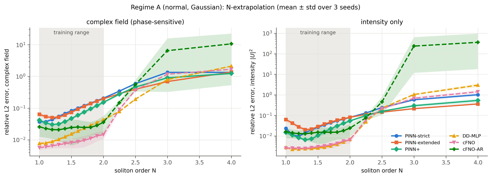
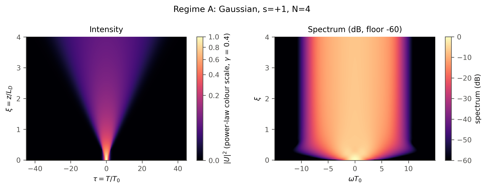
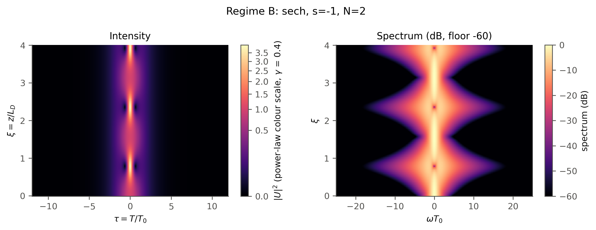
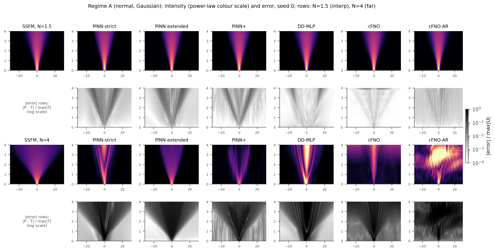
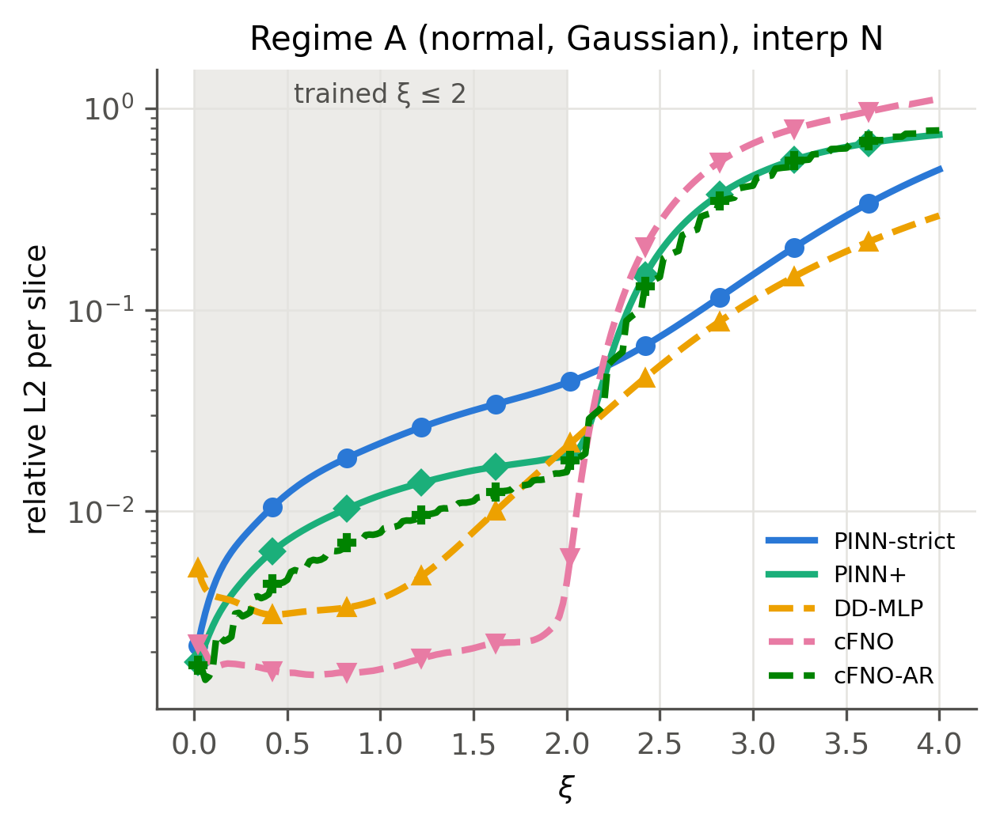
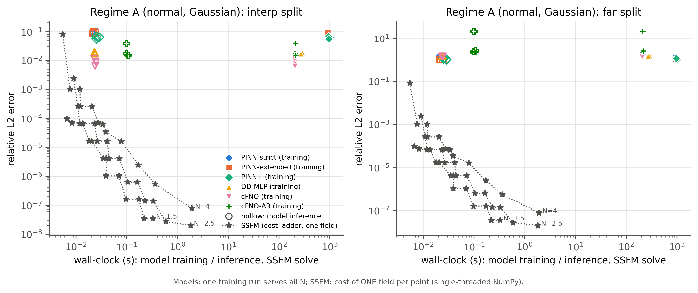

# Do physics-informed neural networks extrapolate better? A controlled study on nonlinear ultrashort-pulse propagation

**Physics-informed vs data-driven learning for the nonlinear Schrödinger equation (NLSE) in optical fibers, tested
*outside* the training distribution.**

*Ultrafast Optics course project (ML in ultrafast science), IIT Bombay.*

<p align="center">
  
</p>

## TL;DR

Jiang et al. (*Laser & Photonics Reviews*, 2022) showed that physics-informed neural networks (PINNs) can simulate
pulse propagation in fibers, and can generalize between training conditions. They only ever tested **interpolation**.
We ask the question that matters for a surrogate model: **what happens outside the training range?** That means
higher soliton order *N*, or longer propagation distance *ξ*.

We compared three PINN variants against a data-driven MLP and two Fourier neural operators. The protocol was
pre-registered: test sets were fixed in git before any training, every model got equal optimizer steps, there were
3 seeds, and the ground truth was a validated solver. We found:

1. **Inside the training range, the data-driven models win.** The neural operator and the plain MLP are several
   times more accurate than every PINN variant, in every regime, and cheaper to train.
2. **Far outside it, every model fails on the full complex field** (the phase is lost). But **physics-informed
   models fail gracefully.** Their predicted intensity and energy stay far closer to physical reality, while the
   data-driven MLP produces unphysical pulses.
3. **For extrapolation in propagation distance, no model class wins everywhere.** The best model in one dispersion
   regime is the worst in the other.
4. **A classical split-step Fourier solver beats every learned model on accuracy, and is often faster than model
   *inference*.** Physics-only fine-tuning at the new condition does not close the gap.
5. **Two diagnostics:**
   - PINN error closely follows a closed-form physical quantity, the accumulated SPM phase *N²·asinh(ξ)*.
   - Energy-conservation drift is a usable *label-free* warning sign for bad predictions. The PDE residual is
     misleading when comparing different model families.

The full generated results are in [`report/results_summary.md`](report/results_summary.md).

---

## 1. Background

### Physics
Pulse propagation in a lossless fiber with group-velocity dispersion (GVD) and self-phase modulation (SPM) obeys the
normalized NLSE:

$$ i\,\frac{\partial U}{\partial \xi} = \frac{s}{2}\,\frac{\partial^2 U}{\partial \tau^2} - N^2 |U|^2 U, \qquad
N^2 = \frac{L_D}{L_{NL}} = \frac{\gamma P_0 T_0^2}{|\beta_2|} $$

Here *U = A/√P₀*, *ξ = z/L_D*, *τ = T/T₀*, and *s = sgn(β₂)*: *s* = +1 is normal dispersion and −1 anomalous.

The soliton order *N* sets the balance between dispersion and nonlinearity:
- *N* = 1 in anomalous dispersion is the shape-preserving fundamental soliton.
- *N* = 2, 3 are breathing higher-order solitons.
- Large *N* in normal dispersion gives strong spectral broadening and optical wave breaking.

<p align="center">
  
  
</p>

### Models compared

| Model | Sees simulated fields? | Sees the PDE? | Notes |
|---|---|---|---|
| **PINN-strict** | initial pulse only | yes, at training N | network (ξ, τ, N) → (Re U, Im U), trained on the PDE residual + initial condition |
| **PINN-extended** | initial pulse only | yes, at training **and test** N | uses the physics at test conditions, with no labels there (the PINN's legitimate advantage) |
| **PINN+** | initial pulse only | yes | + periodic Fourier features, causal training (Wang et al. 2024), adaptive loss weights |
| **DD-MLP** | full fields at training N | no | **identical** network and optimizer schedule to the PINN |
| **cFNO** | full fields at training N | no | Fourier neural operator conditioned on (N, ξ) |
| **cFNO-AR** | full fields at training N | no | autoregressive step operator, rolled out in ξ |
| **SSFM** | – | exact | reference solver; also timed at matched accuracy |

## 2. The original paper and what we changed

**Foundation paper:** X. Jiang, D. Wang, Q. Fan, M. Zhang, C. Lu, A. P. T. Lau, *Physics-Informed Neural Network for
Nonlinear Dynamics in Fiber Optics*, Laser & Photonics Reviews **16**, 2100483 (2022), [arXiv:2109.00526](https://arxiv.org/abs/2109.00526).
Starting code: [xieyulai/fiber-nlse-pinn](https://github.com/xieyulai/fiber-nlse-pinn), an unofficial re-implementation
included as a pinned submodule.

What the paper showed:
- A 4×100 tanh PINN reproduces dispersion, SPM, higher-order effects and solitons with ~1e-3 to 1e-2 error.
- A PINN with peak power as an input **interpolates** between training powers.
- A PINN beats a data-driven network **when that network only gets a few field snapshots of a single scenario**.
- By multiplication count, a PINN needs fewer operations than the split-step solver.

| | Original paper | This project |
|---|---|---|
| Generalization test | interpolation between training powers only | interpolation, **near and far extrapolation in N**, and **extrapolation in distance ξ** |
| Parameter range | peak power 0.5-1.5 (≈ N 0.71-1.22) | N 1-2 for training, tested to N = 4; anomalous regime crossing into soliton breathing |
| Data-driven baseline | small MLP with a few snapshots | same-size MLP with full simulated data, **plus two neural operators** |
| Fairness | not specified | identical trunk, schedule, batch and sampling; equal optimizer steps (enforced by tests) |
| Test-set integrity | not stated | splits **pre-registered and committed before training**; leakage-guarded loaders and tests |
| Randomness | single runs | 3 seeds, mean ± std, robustness labels |
| Ground truth | not documented | SSFM validated against analytic solutions, conservation laws (< 1e-6) and grid convergence |
| Metrics | complex-field relative L2 | plus intensity, phase, spectral (dB), observables, energy and Hamiltonian drift, PDE residual |
| Cost comparison | multiplication count, training excluded | measured wall-clock for training and inference, plus SSFM time at matched accuracy |
| Failure analysis | – | spectral-shift predictors (extending Fesser et al. 2023) and label-free error estimators |
| Errata found | – | L_D and N² misprinted as ∝ 1/\|β₂\|²; β₂ units printed as ps/km (should be ps²/km); one bug and a figure-numbering mismatch in the starter code |

We also **reproduced the starter code's published numbers** before building our own version. The values are
generated in [`results/repro_repo.md`](results/repro_repo.md), and the audit is in
[`report/repo_audit.md`](report/repo_audit.md).

## 3. Experimental protocol

- **Regime A (primary):** normal dispersion, Gaussian input.
  - Train N ∈ {1.0, 1.2, …, 2.0}.
  - Test splits: interp {1.1, …, 1.9}, near {2.25, 2.5}, far {3, 4}.
- **Regime B:** anomalous dispersion, sech and Gaussian inputs.
  - Train N ∈ {0.8, …, 1.6}.
  - Test splits: interp {0.9, …, 1.5}, extrap {2, 3}.
- **z-extrapolation:** train on ξ ≤ 2, evaluate on ξ ∈ (2, 4].
- **Budget:** all MLP-based models get 2k Adam + 20k L-BFGS steps; the operators get the same 22k total steps.
  Hyperparameters were tuned **only on the Regime A interpolation split**. 3 seeds.
- **Grids** were validated per regime (edge energy, step and grid halving, conservation < 1e-6):
  [`configs/grid.yaml`](configs/grid.yaml), [`figures/ssfm_validation.png`](figures/ssfm_validation.png).

Every decision, including problems found and fixed along the way, is logged in [`DECISIONS.md`](DECISIONS.md). The
phase-by-phase log is in [`PROGRESS.md`](PROGRESS.md).

## 4. Results

<!-- RESULTS:START -->
*This block is generated by `scripts/make_summary.py` from `results/`. Relative L2 errors, mean over 3 seeds (per seed: mean over the split's N values). Full tables with std/median: `report/tables/`.*

**Regime A: normal dispersion, Gaussian pulse, N-extrapolation**

| Model | In-distribution (interp N) | Near extrapolation (complex field) | Far extrapolation (complex field) | Far extrapolation (intensity) | Far: max energy drift (ΔE/E, ideal 0) |
|---|---|---|---|---|---|
| PINN-strict | 9.3% | 46.8% | 134.4% | 80.0% | 0.88 |
| PINN-extended | 9.2% | 34.0% | **103.1%** | **28.8%** | **0.47** |
| PINN+ | 6.2% | 37.0% | 107.5% | 41.8% | 0.71 |
| DD-MLP | 1.8% | **13.5%** | 145.6% | 201.8% | 1.27 |
| cFNO | **0.9%** | 23.1% | 143.0% | 105.4% | 12.88 |
| cFNO-AR | 2.4% | 35.3% | 858.8% | 30002.7% | 4051.76 |

**Regime B: anomalous dispersion, sech pulse, N-extrapolation**

| Model | In-distribution (interp N) | Far extrapolation (complex field) | Far extrapolation (intensity) | Far: max energy drift (ΔE/E, ideal 0) |
|---|---|---|---|---|
| PINN-strict | 19.7% | 159.4% | 104.4% | 1.60 |
| PINN-extended | 28.6% | **98.3%** | 78.6% | **0.49** |
| PINN+ | 19.2% | 119.4% | 70.0% | 0.53 |
| DD-MLP | 4.0% | 303.3% | 521.4% | 9.03 |
| cFNO | **2.2%** | 208.4% | 115.9% | 9.90 |
| cFNO-AR | 2.2% | 126.8% | **66.2%** | 0.94 |

**Regime B: anomalous dispersion, Gaussian pulse, N-extrapolation**

| Model | In-distribution (interp N) | Far extrapolation (complex field) | Far extrapolation (intensity) | Far: max energy drift (ΔE/E, ideal 0) |
|---|---|---|---|---|
| PINN-strict | 22.1% | 145.7% | 89.3% | 1.00 |
| PINN-extended | 26.4% | **108.0%** | 77.1% | **0.45** |
| PINN+ | 19.1% | 117.1% | **67.2%** | 0.47 |
| DD-MLP | 3.3% | 314.2% | 488.0% | 7.93 |
| cFNO | 2.9% | 174.7% | 78.4% | 10.35 |
| cFNO-AR | **2.6%** | 162.8% | 103.9% | 2.09 |

**z-extrapolation** (trained on ξ ≤ 2, evaluated on ξ ∈ (2, 4], interp N)

| Model | A: complex field | B_sech: complex field |
|---|---|---|
| PINN-strict | 23.8% | 50.3% |
| PINN+ | 48.7% | 26.2% |
| DD-MLP | **15.3%** | 72.1% |
| cFNO | 70.4% | 29.3% |
| cFNO-AR | 48.3% | **12.3%** |

**Median training time per run:** DD-MLP 6.1 min, cFNO 7.0 min, cFNO-AR 7.1 min, PINN-strict 15.4 min, PINN-extended 15.8 min, PINN+ 16.1 min. Main sweep: 84 runs, 0 diverged.
<!-- RESULTS:END -->

<p align="center">
  
</p>

*Above: true and predicted intensity and log-error maps at an interpolation N (top) and at N = 4, far extrapolation
(bottom). At N = 4 every model is wrong in detail. The physics-informed models keep the broadening "fan" of the true
pulse, while the data-driven models predict a narrow, too-bright core.*

<p align="center">
  
</p>

*Above: error vs ξ when training only on ξ ≤ 2. Every model degrades past the training distance, at very different
rates, and the ranking differs between regimes.*

<p align="center">
  
</p>

*Above: accuracy vs wall-clock. Filled markers are model training, hollow markers model inference, and stars a
coarse-to-fine SSFM cost ladder for one field. For this 1-D problem the classical solver is the bar to beat.*

### Why do models fail where they do?
- **Analysis A, spectral shift** ([`fig_error_vs_spectral_shift`](figures/fig_error_vs_spectral_shift.png)).
  Extrapolation error correlates with how far the spectrum moves (Wasserstein-Fourier distance, after Fesser et al.
  2023), and for PINNs especially with the closed-form accumulated SPM phase *N² asinh ξ*.
- **Analysis B, label-free error estimates** ([`fig_drift_vs_error`](figures/fig_drift_vs_error.png)). At a fixed N,
  the prediction with lower energy drift tends to be the more accurate one. The PDE residual is *anti*-correlated
  with error across model families in N-extrapolation: PINNs produce smooth, nearly PDE-consistent fields that are
  nonetheless less accurate.
- **Ablations** ([`fig_ablation_components`](figures/fig_ablation_components.png),
  [`fig_ablation_range_width`](figures/fig_ablation_range_width.png)). Periodic Fourier features are essential for
  PINN+. Collocation count is not the bottleneck. A lower initial-condition weight would improve the PINNs (it was
  not tuned for the main study). The data-driven models collapse with only 2 training conditions.
- **Test-time fine-tuning** ([`fig_finetune`](figures/fig_finetune.png)). Fine-tuning the PINN with physics only at
  the far N improves it, but does not reach its in-distribution accuracy within ~10 minutes. The SSFM gets there in
  milliseconds.

All numbers: [`report/results_summary.md`](report/results_summary.md). Every figure and the command that regenerates
it: [`report/figure_index.md`](report/figure_index.md).

### How does this relate to the paper's claim that PINNs beat data-driven networks?
It doesn't contradict it, because it tests a different setting:
- The paper's comparison was **data-scarce**: one scenario, a few snapshots. There the PDE supplies information
  the data lacks.
- Ours is the **parametric-surrogate** setting: simulated training data is cheap and plentiful, and the question is
  generalization.

There, data-driven models are more accurate wherever they have data, and physics buys *plausibility*, not accuracy,
far from it.

## 5. Limitations
- **The PINNs reach worse in-distribution accuracy** than the data-driven models at the equal-step budget, so the
  extrapolation comparison starts from unequal baselines. The IC weight was not tuned, and hyperparameters were tuned
  on Regime A only.
- **The complex-field error saturates once the phase is lost.** We therefore also report intensity, spectral and
  energy metrics.
- Three seeds per configuration. Small differences are labelled "not robust" in the summary.
- A single physical model: the lossless scalar NLSE, without higher-order effects.
- Not run, for time: Gaussian-input z-extrapolation in Regime B, inverse parameter retrieval, and the float64 and
  noise ablations.

## 6. Repository layout

```
configs/      splits.yaml (pre-registered), grid.yaml (validated), models/*.yaml, ablations.yaml
src/nlse_ml/  physics/ (SSFM, RK4IP, analytic, conservation), data/ (generation, leakage-guarded loaders),
              models/ (MLP with exact forward-mode derivatives, PINN residuals, FNO), train/, eval/, viz/
scripts/      numbered pipeline steps, run_experiment.py, run_sweep.py, make_tables/figures/summary
tests/        physics, residuals, metrics, splits/leakage and fairness tests
results/      aggregated CSVs (committed)      figures/  PNG + PDF (committed)
report/       results_summary.md, figure_index.md, tables/, repo_audit.md, literature_notes.md, references.bib
third_party/  fiber-nlse-pinn (starter code, pinned submodule, MIT)
```

## 7. Setup

```bash
git clone --recurse-submodules https://github.com/ShreyasVR2545/ultrafast-pinn-extrapolation
cd ultrafast-pinn-extrapolation
python -m venv .venv            # Python 3.12
# Windows: .venv\Scripts\activate    macOS/Linux: source .venv/bin/activate
pip install torch==2.7.1 --index-url https://download.pytorch.org/whl/cu128   # or plain `pip install torch==2.7.1` for CPU
pip install -r requirements.txt
pytest
```

## 8. Reproduce

Runtimes were measured on an RTX 5070 Laptop GPU (8 GB) with an Intel Core Ultra 9 275HX.

**From the committed results only (no GPU, no data):**
```bash
python scripts/make_tables.py              # report/tables/*
python scripts/make_figures.py             # core figures; heatmaps/spectra need data/ + runs/ (skipped otherwise)
python scripts/09_novel_analyses.py --figures-only
python scripts/make_ablation_figures.py
python scripts/make_summary.py             # report/results_summary.md and the README results block
```
On a fresh clone these regenerate byte-identical PNGs, tables and summary.

**Full pipeline from scratch:**

| Step | Command | Runtime |
|---|---|---|
| Environment report and benchmarks | `python scripts/00_env_check.py`, `python scripts/01_benchmark.py` | 2 min |
| Starter-code reproduction | `python scripts/02_reproduce_repo.py --presets fig3 fig7 fig8 --seeds 0 1 2` | ~25 min per fig3/fig7 seed; fig8 ~2.3 h per seed |
| SSFM validation, grid, gallery | `python scripts/03_validate_ssfm.py` | 13 min (CPU) |
| Datasets (37 fields, 146 MB) | `python scripts/04_generate_data.py` | 2 min (CPU) |
| SSFM cost ladder | `python scripts/05_ssfm_cost.py` | ~10 min (CPU) |
| One experiment | `python scripts/run_experiment.py --model pinn_strict --regime A --exp n_extrap --seed 0` | PINN ~15 min, DD-MLP ~6 min, cFNO ~4-7 min |
| Main sweep (84 runs) | `python scripts/run_sweep.py --blocks a b c d --seeds 0 1 2` | 14.8 h |
| Ablations (23 runs) | `python scripts/run_sweep.py --plan configs/ablations.yaml --sweep ablations` | 4.6 h |
| Analyses A and B | `python scripts/09_novel_analyses.py` | ~3 min (CPU) |
| Fine-tuning vs SSFM | `python scripts/10_finetune.py --seeds 0` | 45 min |
| Tables, figures, summary | `python scripts/make_tables.py --aggregate`, `python scripts/make_ablation_figures.py --aggregate`, then the commands above | ~2 min |

Every training and simulation script supports `--smoke` (under 60 s).

## 9. Conventions and verification
- SSFM linear step: Û ← exp(i s ω² h/2) Û.
- PINN residuals, for *U = u + iv*:
  - *f = −v_ξ − (s/2)u_ττ + N²(u²+v²)u*
  - *g = u_ξ − (s/2)v_ττ + N²(u²+v²)v*
- Conserved quantities:
  - energy *E = ∫|U|²dτ*;
  - Hamiltonian *H = ∫[(s/2)|U_τ|² + (N²/2)|U|⁴]dτ*.

Every formula is checked numerically in `tests/`.

Physical scale, for SMF-28 at 1550 nm: β₂ ≈ −21.7 ps²/km and γ ≈ 1.3 W⁻¹km⁻¹, so *L_D = T₀²/|β₂|*.

**Causal training note:** PINN+ uses the causal weighting of Wang, Sankaran & Perdikaris (CMAME 2024). That method
is patented for commercial use; academic use, as here, is fine.

## 10. References
- X. Jiang et al., *Laser Photonics Rev.* 16, 2100483 (2022).
- L. Fesser, L. D'Amico-Wong, R. Qiu, arXiv:2306.09478 (2023), spectral shifts and PINN extrapolation.
- S. Wang, S. Sankaran, P. Perdikaris, *CMAME* 421, 116813 (2024), causal training.
- A. Krishnapriyan et al., NeurIPS (2021), PINN failure modes.
- Z. Li et al., ICLR (2021), Fourier neural operator.
- N. McGreivy & A. Hakim, *Nat. Mach. Intell.* 6, 1256 (2024), weak baselines in ML for PDEs.
- G. P. Agrawal, *Nonlinear Fiber Optics*.

Full notes and BibTeX: [`report/literature_notes.md`](report/literature_notes.md),
[`report/references.bib`](report/references.bib).

## Acknowledgements
The starter code is [xieyulai/fiber-nlse-pinn](https://github.com/xieyulai/fiber-nlse-pinn) (MIT). The project was
built with AI assistance (Claude Code). All design decisions, diagnostics and corrections are logged in
`DECISIONS.md`.
